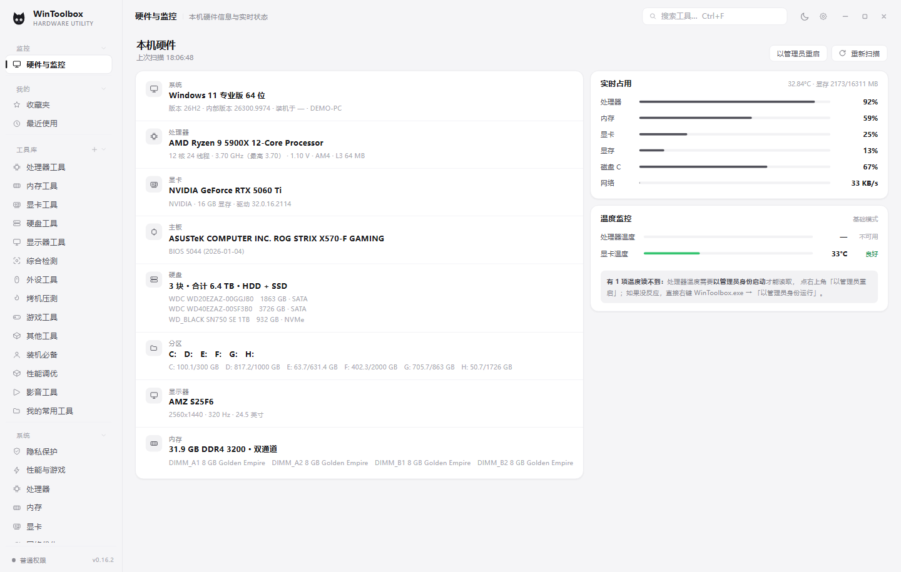
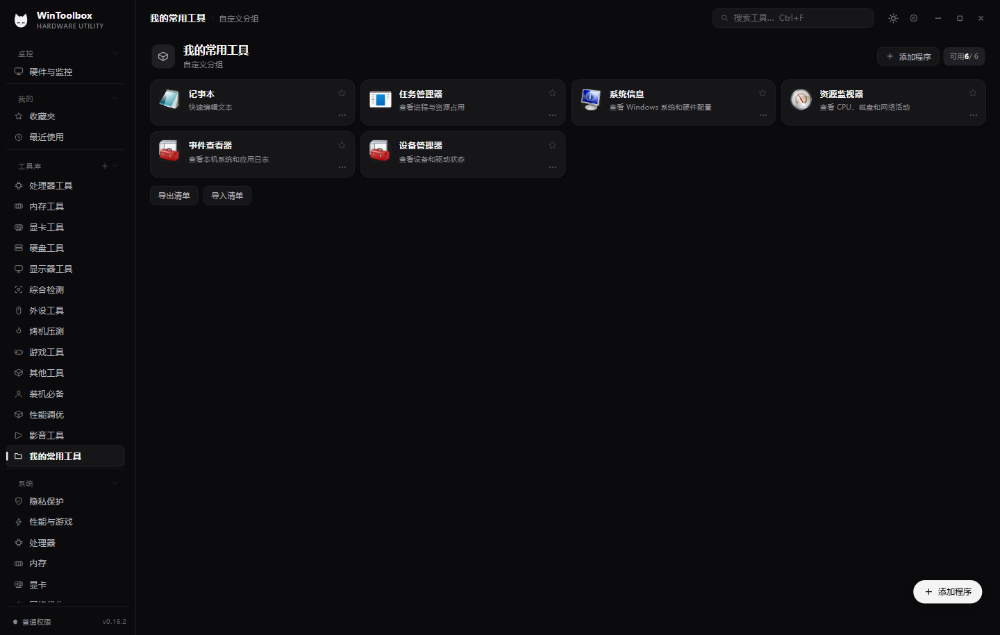
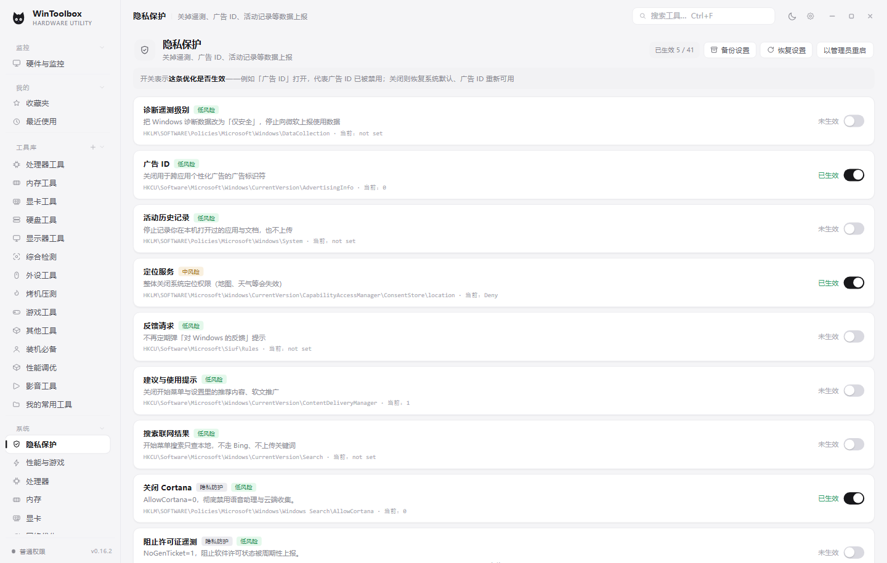
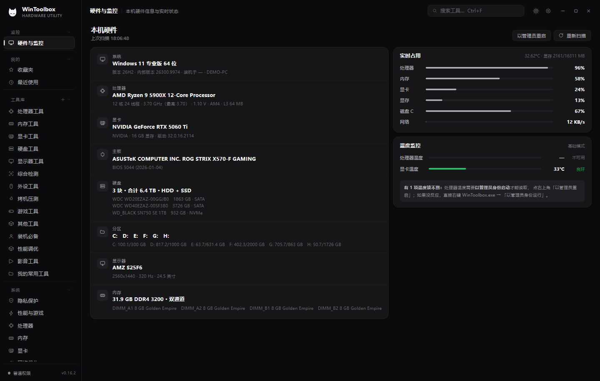
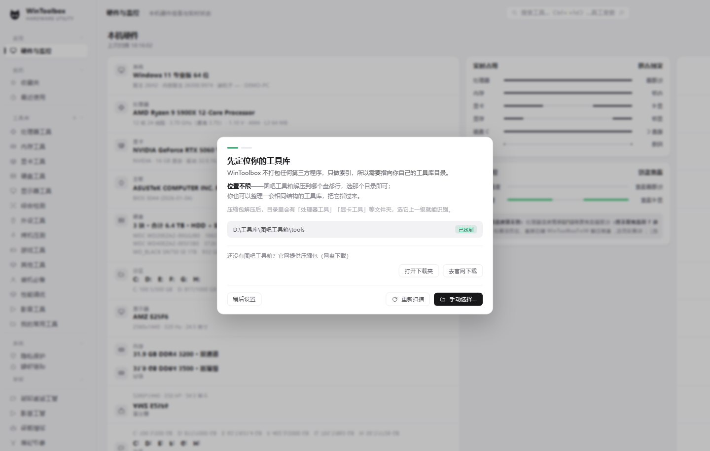
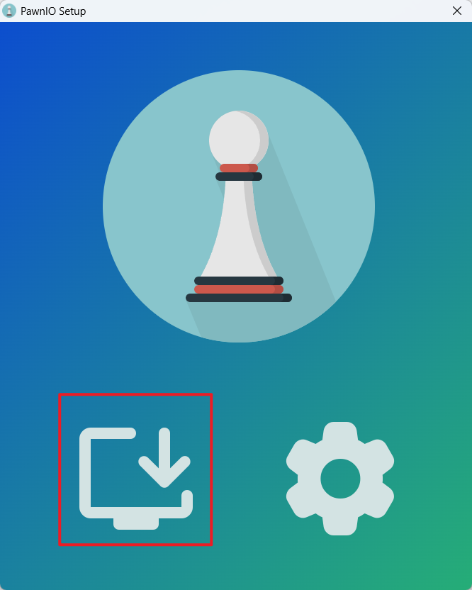

# WinToolbox

**一个界面，管住你的整台 Windows。**
图吧工具箱的工具库 + 你自己收藏的小众程序 + 系统里藏得深的开关，全部收进一个可搜索、可收藏、可一键启动的面板。

`v0.16.3` · 免安装版 · Windows 10/11 x64 · 简体中文 / English

[下载 GitHub 免安装版](https://github.com/Shmi11y/WinToolbox/releases/latest)

> 下文按 v0.16.3 说明，部分界面截图采自 v0.16.2。

---

## 为什么会有这个软件

图吧工具箱是个好东西，装完就是一百多个硬件工具的集合。但它有个绕不过去的限制：

**里面的程序是固定的。**

今天要用的小工具它没有，明天朋友发来一个单文件绿色软件，后天又下了个只有作者自己在维护的驱动工具——这些东西慢慢散在「下载」、桌面、「新建文件夹(3)」里。等真要用的时候，你得凭记忆翻。

于是就有了 WinToolbox。它只做三件事：

1. **把你的图吧工具箱接进来** —— 一百多个工具一个列表，`Ctrl+F` 就能找到
2. **把你自己的程序也接进来** —— 拖一个 exe 进去就完事，和内置工具平起平坐
3. **把 Windows 的系统设置也接进来** —— 收录 234 项调优，支持检测的项目会告诉你「现在到底生不生效」

它不是图吧的替代品，是**在你已有工具之上加的一层统一入口**。

---

## 它能做什么

| 板块 | 你得到什么 |
|---|---|
| **工具库** | 图吧的工具 + 自己的程序 + 收藏 + 最近使用，统一搜索、图标、一键启动 |
| **硬件与监控** | CPU / 显卡 / 内存 / 硬盘 / 分区 / 显示器 / 网络，型号参数一屏看完，温度与占用实时刷新 |
| **系统调优** | 收录 234 项（隐私、性能、桌面、服务、清理、修复），支持的设置可读取真实状态、应用和恢复 |
| **配置备份** | 把 199 项设置状态导出成一个 JSON，换机重装一键还原 |

---

## 界面









---

## 一、工具库：图吧的 + 你的，放在一起

### 接入图吧工具箱

首次启动会自动扫描磁盘找「图吧工具箱」目录（优先看「下载」和「桌面」，实测 8 秒内出结果）。找到后一键接入，设置里随时能改。

找不到也可以手动选。**位置不限**——解压到哪个盘都行，指向那一层就认。甚至可以指向你自己整理的一套同结构工具库。

还没有图吧工具箱？引导页有官网下载入口，装好回来点「重新扫描」即可。

### 添加自己的程序

三种方式，任选：

| 方式 | 操作 |
|---|---|
| 拖拽 | 直接把 exe / lnk / bat / url 拖进窗口 |
| 悬浮按钮 | 右下角「+ 添加程序」，只在工具相关页面出现 |
| 快捷键 | `Ctrl + N` |

支持批量多选，可添加 `.exe` 应用、`.lnk` 和 `.url` 快捷方式、`.bat` 和 `.cmd` 批处理、`.msc` 和 `.cpl` 系统工具、文件夹及 PDF、Word、Excel 等常用文档。也能登记 `.zip`、`.7z`、`.rar` 压缩包，点击后在资源管理器里定位。

加进来的程序和内置工具**完全同等**：有图标、能搜索、能收藏、能记启动次数、能看「用过几次」。

### 文件缺失了怎么办

卡片灰掉时会显示「文件缺失」，后面直接跟一个按钮：

- 图吧的工具 → **检查工具库**（打开设置改路径）
- 自己的程序 → **重新指定**（弹文件选择框，重指 exe）

不用去翻右键菜单猜。

### 搜索是全局的

搜索框（`Ctrl + F`）不只搜工具，**同时搜 234 个系统项**——按名称、描述、注册表路径匹配。

```
搜「遥测」→ “遥测” · 7 个匹配（工具 0 / 系统 7）

  诊断遥测级别          隐私保护    前往 ›
  连接用户体验和遥测     系统隐私    前往 ›
  阻止许可证遥测        隐私保护    前往 ›
```

点一条直接跳到那个分组，滚动定位到该项，闪烁 1.6 秒标出来。

---

## 二、硬件与监控

打开就是整机状态，不用开五个软件：

- **系统**：版本、内部版本号、装机日期、运行时长
- **处理器**：型号、核心/线程、基频、缓存、当前频率
- **显卡**：型号、显存、驱动版本
- **内存**：容量、频率、通道、插槽占用
- **硬盘 / 分区**：型号、接口、健康度、容量、剩余
- **显示器**：型号、尺寸、分辨率、刷新率
- **右侧实时**：CPU / 内存 / 显卡 / 磁盘 / 网络占用，每秒刷新

温度部分：CPU、显卡、硬盘、主板，带「良好 / 正常 / 偏高 / 过热」状态判定。

> 温度读不到？见 [温度为什么是空的](#温度为什么是空的)

---

## 三、系统调优：234 项，读的是真实状态

这是最能体现"不做假开关"的一块。

### 查看真实状态

对可检测的项目，应用会读取注册表、服务、计划任务或电源设置，再显示实际状态：

```
[✓] 诊断遥测级别       已生效      当前值：0
[ ] 广告 ID            未生效      当前值：1
```

顶部计数实时显示：`已生效 5 / 41`。

### 15 个分组

隐私保护 · 性能与游戏 · 处理器 · 内存 · 显卡 · 网络优化 · 任务与启动 · 桌面体验 · 外设与输入 · 系统服务 · 音频 · 系统行为 · 清理 · 修复与还原 · 其它优化

### 风险分级

每项标了「低 / 中 / 高」。高风险项（比如关闭驱动签名强制）在从配置备份恢复时**默认跳过**，界面会列出具体项目供确认。

### 应用和恢复

在分组内可以单项应用或恢复默认，需要同时恢复多项时可使用「恢复设置」，按备份文件逐项写入。

### 检测是批量的

一组 41 项一次读完，**4.1 秒**（逐项起进程要 15–20 秒）。结果缓存 2 分钟，切来切去不重复扫。

---

## 四、配置备份与还原

重装系统前做一次备份，回来一键还原。

```json
{
  "app": "WinToolbox",
  "appVersion": "0.16.3",
  "exportedAt": "2026-11-21T17:20:00+08:00",
  "machine": "DESKTOP-XXXX",
  "items": {
    "ad-id": { "name": "广告 ID", "applied": true, "current": "0", "risk": "low" }
  }
}
```

- 覆盖 199 项可持久化设置
- 恢复时按风险分级：低/中直接应用，高风险先列名单
- 完成后告诉你多少项需要重启才生效

> 只备份**开关状态**，不含已安装软件、浏览器数据、驱动。

---

## 五、外观与语言

- **主题模式**：跟随系统 / 浅色 / 深色
- **动效**：完整 / 精简 / 关闭（远程桌面、低配机建议关）
- **侧栏宽度**：窄 168 / 标准 196 / 宽 228
- **语言**：简体中文 / English
  只翻界面外壳，工具名保持原文——`CPU-Z` 翻成中文反而没人找得到

强调色固定墨玉绿 `#2E9E6B`：出现即代表"生效 / 正常"。

---

## 六、界面与交互

这个软件的界面没有用任何 UI 框架，全部是手写的 CSS。有几处是特意做的。

### 白天 / 黑夜，图标跟着换

不是简单换个配色，而是**整套图标与过渡一起变**：

| 元素 | 切换时的表现 |
|---|---|
| 主题按钮 | 月亮 **旋转 70° 缩小到 45%** 淡出，太阳同时 **从 -70° 转正、放大到 100%** 淡入 |
| 左上角猫头 | 亮/暗两版 Logo **交叉淡入**，暗版从 92% 放大到 100% |
| 背景、卡片、描边 | 200ms 过渡，曲线 `cubic-bezier(.33,.72,0,1)` —— 起步快、收尾稳 |
| 文字与图标颜色 | **只用 90ms**，先于背景到位 |

最后那条是有原因的：如果文字和背景一起做 200ms，中途会出现"灰底灰字"的低对比瞬间，眼睛会难受。所以让**面慢慢走、字先到**。

切换期间还会临时屏蔽悬停态，避免鼠标经过时导航项闪一下。动画结束后自动摘掉过渡，不影响日常操作的跟手度。

### 首次启动的引导

第一次打开时，如果没找到工具库，会弹一个单步引导：

```
先定位你的工具库
  WinToolbox 不打包任何第三方程序，只做索引，所以需要指向你自己的工具库目录。
  **位置不限** —— 图吧工具箱解压到哪个盘都行，选那个目录即可；
  你也可以整理一套相同结构的工具库，把它指过来。

  [ 已找到：D:\图吧工具箱\tools                    ]
  [ 打开下载夹 ]  [ 去官网下载 ]
  ─────────────────────────────────────
  [ 稍后设置 ]              [ 重新扫描 ]  [ 手动选择… ]
```

设计上的几个取舍：

- **扫描优先看「下载」和「桌面」** —— 刚解压出来的目录大概率在这两处，实测 8 秒内命中，不用等全盘扫完
- **候选直接点一下就能选**，不要求你知道该选哪一层（选上一级也认）
- **「稍后设置」放在左下角**，和主操作分开，避免误点
- 找不到工具库也能用：硬件监控、系统调优、自己的程序都不依赖工具库



定位完成后，第二屏会显示识别数和就绪数。实际数量由图吧工具库和你添加的应用决定。

### 其他细节

- **无边框窗口**，标题栏是自己画的，最小化/最大化/关闭和系统行为完全一致
- **侧栏可以拖拽调宽**（168 / 196 / 228 三档吸附），双击复位
- **卡片悬停才出现播放键**，平时不抢注意力；星标固定在右上角，收藏的会常驻金色
- **首次打开有骨架屏**，不是白屏等 3 秒
- 强调色只有一种（墨玉绿 `#2E9E6B`），**出现即代表"生效 / 正常"**，其余全是灰阶
- 深色模式下所有弹窗、toast、右键菜单都跟着变，不会有某个角落还是白底

---

## 快速开始

### 1. 下载

从 [GitHub Releases](https://github.com/Shmi11y/WinToolbox/releases) 下载对应版本的免安装 ZIP。

> 免安装版目前未签名，Windows 可能显示发布者提示。可在 Release 说明中核对 ZIP 的 SHA-256。

### 2. 解压

解压到任意位置（建议非系统盘），得到 `WinToolbox.exe`，无需安装即可启动。

### 3. 双击运行

首次启动会引导你定位工具库：

```
先定位你的工具库
  位置不限 —— 图吧工具箱解压到哪个盘都行，选那个目录即可；
  你也可以整理一套相同结构的工具库，把它指过来。

  [候选目录]   [重新扫描]  [手动选择…]  [去官网下载]
```

没有图吧工具箱也能用：点「稍后设置」，硬件监控和系统调优照常工作，之后随时在设置里补。

### 4. 要改系统设置时

点右上角「以管理员重启」。写 `HKLM`、改服务、跑 SFC/DISM 都需要管理员权限。

---

## 温度为什么是空的

**结论先说：不一定是权限问题。**

部分 CPU 温度需要额外的传感器库和驱动，能否读取也取决于硬件和权限：

| 现象 | 原因 | 怎么办 |
|---|---|---|
| 提示"需要以管理员身份启动" | 权限不够 | 点「以管理员重启」 |
| 管理员了还是空 | 缺少兼容的传感器库，或内存完整性限制旧驱动 | 配置 LibreHardwareMonitor，根据提示尝试使用 PawnIO |
| 装了 PawnIO 还是空 | 传感器或依赖与当前硬件不兼容 | 查看运行日志，核对传感器库与依赖 |

### 配置增强温度读取

先从 [LibreHardwareMonitor 上游](https://github.com/LibreHardwareMonitor/LibreHardwareMonitor/releases)获取与 Windows PowerShell 5.1 兼容的 .NET Framework 版 `LibreHardwareMonitorLib.dll` 及同版依赖。在 WinToolbox 设置页打开数据目录，把这些 DLL 放进 `sensors` 子目录，再以管理员身份启动 WinToolbox。

检测到内存完整性开启且 CPU 温度不可用时，温度提示条会给出 PawnIO 安装入口：

```
[安装温度驱动（PawnIO）]
```

点击后程序从官方 GitHub 下载 PawnIO 2.2.0，核对 SHA-256 和 `namazso.eu` 的 Authenticode 签名，再请求以管理员身份启动安装器。

然后会弹出 PawnIO 自己的安装窗口，只有两步：



1. 点**图中红框里的那个按钮**（屏幕 + 向下箭头，就是「安装到本机」）
2. 弹出确认框点 **「继续 / Continue」**

安装完成后，WinToolbox 会检测 PawnIO，接入 `PawnIOLib.dll` 并重新读取温度。如安装器提示重启，请按提示操作。

> 右边的齿轮只是 PawnIO 自己的设置项，一般不用动。

PawnIO 提供官方签名版本，可尝试在保留内存完整性的情况下读取兼容的传感器。温度功能可选，工具库和调优功能照常使用。

---

## 快捷键

| 键 | 作用 |
|---|---|
| `Ctrl + F` | 聚焦搜索框 |
| `Ctrl + N` | 添加程序 |
| `Enter` | 在搜索结果里启动第一个 |
| `Esc` | 清空搜索 / 关闭弹窗 |

---

## 设置项一览

| 分区 | 内容 |
|---|---|
| 工具库 | 位置 · 识别结果 · 重新扫描 · 更改 · 打开目录 |
| 外观 | 主题模式 · 动效 · 侧栏宽度 · 语言 |
| 行为 | 关闭窗口时最小化到托盘 · 启动时自动检测工具库 |
| 系统与日志 | 运行权限 · 以管理员重启 · 运行日志 · 数据目录 |

第一次点窗口的 × 会问你一次「最小化到托盘还是直接退出」，可以勾选记住。

---

## 数据与隐私

**全部本地，不上传任何东西。** 没有账号，没有统计，没有网络请求（除了你主动点的下载）。

| 内容 | 位置 |
|---|---|
| 偏好、收藏、最近 | `%APPDATA%\tuba-toolbox-next\store.json` |
| 硬件信息缓存 | `%APPDATA%\tuba-toolbox-next\sysinfo-cache.json` |
| 错误日志 | `%APPDATA%\tuba-toolbox-next\error.log` |
| 提权日志 | `%APPDATA%\tuba-toolbox-next\elevation.log` |
| 工具库路径 | `resources\config.json`（也可在设置里改） |

彻底卸载：删掉解压出来的文件夹 + 上面那个 `tuba-toolbox-next` 目录。

---

## 它不做什么

先把边界说清楚，免得误会：

- **不打包任何第三方软件**。工具库只提供索引，程序要你自己获取。仓库里不含 CPU-Z、AIDA64、FurMark 等任何第三方二进制。
- **不替代图吧工具箱**。它是个入口。图吧更新了，你更新图吧的目录就行。
- **不做"一键优化加速"**。每一项改了什么、改成什么值、怎么恢复，都摆在界面上。
- **暂不自动更新**。新版本手动下载。

---

## 常见问题

**Q：工具全灰的，显示"文件缺失"？**
工具库路径指错了。点卡片上的「检查工具库」，或 设置 → 工具库 → 更改。

**Q：为什么有些项在普通权限下改不了？**
写 `HKLM`、改服务、跑 SFC 都要管理员。界面会标出来，点右上角提权。

**Q：改错了能撤销吗？**
单项有「恢复默认」。批量改动之前，建议先做一次配置备份（备份与恢复 → 导出）。

**Q：能开机自启吗？**
暂未内置。可以自己放个快捷方式到 `shell:startup`。

**Q：为什么只有 Windows 版？**
核心功能（注册表、服务、powercfg、WMI）都是 Windows 独有的。

**Q：启动有点慢？**
首次采集硬件信息要 3–6 秒（跑 WMI 和传感器）。之后有 6 小时缓存，秒开。

**Q：软件有多大？**
下载包体积主要来自 Electron 运行时，实际大小见 Release 页面。

---

## 技术栈

Electron + 原生 JS（无框架、无打包器）+ PowerShell。

```
main.js             主进程：窗口、IPC、系统操作（1500 行）
preload.js          API 白名单（62 行）
renderer/
  app.js            界面逻辑（2000 行）
  style.css         样式（1000 行）
  i18n.js           英文词典 + 运行时替换（290 行）
data/
  catalog-tuba.json 工具索引 127 项 / 14 分类
  tweaks.json       自建调优 33 条
  tweaks-yuqi.json  移植调优 201 条
  scripts/          sysinfo.ps1 · tweaks.ps1 · tweaks-detect.ps1 · sensors.ps1
```

构建：

```bash
npm install
npm start              # 开发运行
node tools/build.js    # 打包到 dist/WinToolbox-win32-x64
```

可以从 [`main.js`](main.js)、[`preload.js`](preload.js) 和 [`data/scripts/`](data/scripts/) 查看各模块。

---

## 致谢

- [图吧工具箱](https://tbtool.co/) —— 工具库索引参考，始于 2014 的硬件检测工具集合。
  本仓库**不包含**其任何文件，也未内嵌其收录的第三方程序。
- [LibreHardwareMonitor](https://github.com/LibreHardwareMonitor/LibreHardwareMonitor) —— 温度与传感器采集（MPL-2.0）
- [PawnIO](https://pawnio.eu/) —— 内核隔离环境下的签名驱动
- 收录工具的版权归各自作者所有（CPU-Z、HWiNFO、FurMark 等），本项目仅提供本地索引。

第三方组件许可见 [`THIRD-PARTY-NOTICES.md`](THIRD-PARTY-NOTICES.md)。

---

## Bug 或意见反馈

邮件：[2605155846@qq.com](mailto:2605155846@qq.com)。反馈 Bug 时请附上 WinToolbox 版本、Windows 版本和复现步骤。

---

## 许可

MIT，仅覆盖本项目代码，不含 `data/sensors/` 下的第三方组件。
